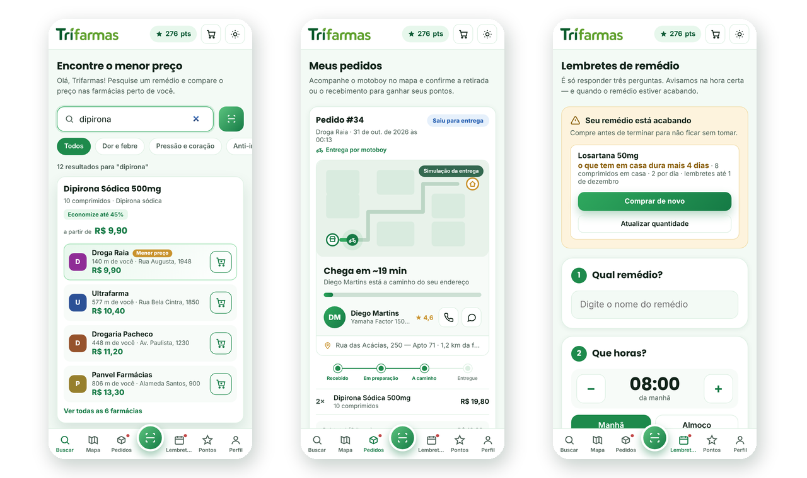

<!-- A logo tem duas versões: a clara aparece no tema escuro do GitHub. -->
<picture>
  <source media="(prefers-color-scheme: dark)" srcset="frontend/assets/logo-dark.png">
  
</picture>


<!-- Quer os badges com os números do repositório (tamanho, forks, issues)?
     Depois de publicar no GitHub, troque SEU-USUARIO/trifarmas pelo caminho real
     e tire estes cinco de dentro do comentário:


-->



> O Trifarmas compara o preço do mesmo remédio em várias farmácias e mostra onde
> sai mais barato perto de você. Dá para montar o carrinho, pagar pelo app, retirar
> na farmácia com um código, lembrar a hora de tomar e juntar pontos que viram desconto.

### Ajustes e melhorias

O projeto ainda está em desenvolvimento e as próximas atualizações serão voltadas para as seguintes tarefas:

- [x] Comparar o preço de mais de 320 remédios e produtos em 6 farmácias
- [x] Entrar com e-mail e senha ou com a conta do Google
- [x] Carrinho, pagamento e código de retirada
- [x] Escolher entre retirar na farmácia ou receber por motoboy, acompanhando a entrega no mapa
- [x] Receita médica: anexar PDF/foto ou mostrar na retirada
- [x] Pontos que viram cupons de desconto
- [x] Mapa com farmácias de verdade ao redor
- [x] Lembretes de remédio em três passos, com repetição por vários dias
- [x] Controle de quantas unidades a pessoa tem em casa, com aviso de reposição quando faltam 5 dias
- [x] Ver a senha enquanto digita
- [x] Modo escuro e tamanho do texto ajustável
- [x] Ler pela câmera o nome escrito na caixa e abrir a comparação de preços
- [ ] Preços de verdade (tabela da CMED e dados das farmácias)
- [ ] Pagamento de verdade com Pix
- [ ] Retirada confirmada pela própria farmácia, no balcão
- [ ] Aplicativo para Android e iPhone

## 💻 Pré-requisitos

Antes de começar, verifique se você atendeu aos seguintes requisitos:

- Você instalou a versão mais recente do `Node.js 20 ou superior` (a API não roda em versões mais antigas).
- Você tem um `PostgreSQL 14 ou superior` rodando na sua máquina — ou um banco gratuito no [Render](https://render.com).
- Você tem o `Python 3` instalado (só para abrir o site durante o desenvolvimento) ou qualquer outro servidor de arquivos.
- Você tem uma máquina `Windows, Linux ou macOS`. O projeto funciona igual nos três.
- Para o login com o Google, você criou um `ID do cliente OAuth` no [Google Cloud Console](https://console.cloud.google.com/apis/credentials).

## 🚀 Instalando o Trifarmas

Para instalar o Trifarmas, siga estas etapas:

Linux e macOS:

```bash
git clone https://github.com/SEU-USUARIO/trifarmas.git
cd trifarmas/backend
cp .env.example .env     # abra o .env e preencha DATABASE_URL e JWT_SECRET
npm install
```

Windows:

```powershell
git clone https://github.com/SEU-USUARIO/trifarmas.git
cd trifarmas\backend
copy .env.example .env   # abra o .env e preencha DATABASE_URL e JWT_SECRET
npm install
```

Na primeira vez que a API subir, ela cria as tabelas sozinha e já preenche o
catálogo com as farmácias, os mais de 320 remédios e as recompensas.

## ☕ Usando o Trifarmas

Para usar o Trifarmas, siga estas etapas:

```bash
# 1. a API (pasta backend)
npm run dev                    # http://localhost:3000

# 2. o site (em outro terminal, pasta frontend)
python3 -m http.server 8000    # no Windows: py -m http.server 8000
```

Abra `http://localhost:8000` e entre com a conta de teste que já vem criada:

```
e-mail: trifarmas@gmail.com
senha:  123456
```

Com o app aberto, você pode:

- **Buscar um remédio** pelo nome ou pelo princípio ativo (funciona com ou sem acento) e ver o preço em cada farmácia, da mais barata para a mais cara.
- **Apontar a câmera** para a caixa (ou para um papel escrito): o app lê o texto e abre a comparação de preços daquele remédio.
- **Montar o carrinho** e comparar quanto o pedido inteiro custa em cada farmácia antes de pagar.
- **Escolher como receber**: retirar na farmácia (grátis) ou **entrega por motoboy** — a taxa aparece depois do endereço e é calculada por km (R$ 5,00 até 2 km + R$ 1,50 por km rodado).
- **Pagar** (simulado) e receber o **código de retirada** (ou de entrega) na aba Pedidos.
- **Acompanhar o motoboy** no mapa, do balcão da farmácia até a sua casa, com o tempo que falta e os dados do entregador.
- **Resolver a receita** dos remédios que exigem: anexar PDF/foto ou mostrar na retirada.
- **Criar lembretes** em três toques — remédio, horário e dia —, com opção de repetir por 7, 15 ou 30 dias.
- **Ser avisado quando o remédio estiver acabando**: ao criar o lembrete você informa quantas unidades tem em casa; o app desconta a cada dose, calcula para quantos dias dá e avisa faltando 5 dias, com atalho para comprar de novo.
- **Ver as farmácias ao redor** no mapa, pela localização do aparelho ou digitando o CEP.
- **Juntar pontos** (1 ponto a cada R$ 1 pago) e trocar por cupons de desconto.

Para conferir se a API está no ar, abra `http://localhost:3000/health` — a resposta
deve ser `{"ok":true}`.

## 🌐 Publicando na internet

O projeto é dividido em duas partes, publicadas em lugares diferentes:

| Pasta       | O que é                                | Onde publicar |
|-------------|----------------------------------------|---------------|
| `frontend/` | Site estático (HTML, CSS, JS, imagens) | **Vercel**    |
| `backend/`  | API Node.js + banco PostgreSQL         | **Render**    |

**Render (backend):** crie um banco PostgreSQL (plano free) e um Web Service com
*Root Directory* `backend`, *Build* `npm install` e *Start* `npm start`. Preencha as
variáveis `DATABASE_URL`, `JWT_SECRET`, `GOOGLE_CLIENT_ID` e `CORS_ORIGINS`
(a URL do Vercel). O arquivo `backend/render.yaml` faz tudo isso de uma vez pelo
menu *New + → Blueprint*.

**Servidor dormindo:** no plano gratuito do Render, a API hiberna depois de 15 minutos
sem acesso e leva quase um minuto para ligar de novo. O app já acorda o servidor assim
que a tela de login abre, enquanto a pessoa digita a senha. Para o primeiro acesso do dia
ser instantâneo, crie um ping gratuito (UptimeRobot, cron-job.org) chamando
`https://SEU-APP.onrender.com/health` a cada 10 minutos.

**Vercel (site):** aponte `API_URL` em `frontend/config.js` para o endereço do
Render, crie o projeto com *Root Directory* `frontend` e *Framework Preset* **Other**.
Por fim, adicione a URL do Vercel nas *Origens JavaScript autorizadas* do seu
Client ID do Google.

## 📫 Contribuindo para o Trifarmas

Para contribuir com o Trifarmas, siga estas etapas:

1. Bifurque este repositório.
2. Crie um branch: `git checkout -b <nome_branch>`.
3. Faça suas alterações e confirme-as: `git commit -m '<mensagem_commit>'`
4. Envie para o branch original: `git push origin trifarmas / <local>`
5. Crie a solicitação de pull.

Como alternativa, consulte a documentação do GitHub em [como criar uma solicitação pull](https://help.github.com/en/github/collaborating-with-issues-and-pull-requests/creating-a-pull-request).

## 🤝 Colaboradores

Agradecemos às seguintes pessoas que contribuíram para este projeto:

<table>
  <tr>
    <td align="center">
      <a href="https://github.com/SEU-USUARIO" title="Perfil no GitHub">
        <br>
        <sub>
          <b>Time Trifarmas</b>
        </sub>
      </a>
    </td>
    <!-- Para adicionar alguém, copie o bloco <td> acima e troque o link, a imagem e o nome. -->
  </tr>
</table>

## 😄 Seja um dos contribuidores

Quer fazer parte desse projeto? Veja [como contribuir](#-contribuindo-para-o-trifarmas) e abra a sua solicitação de pull.

## 📝 Licença

Esse projeto está sob a licença MIT. Veja o arquivo [LICENSE.md](LICENSE.md) para mais detalhes.

---

Os preços, o pagamento, a aprovação da receita e a entrega por motoboy deste app são
**simulados**, para fins de estudo. Nenhuma cobrança é feita e nenhum motoboy é chamado
de verdade — o trajeto que aparece no mapa é uma animação.
